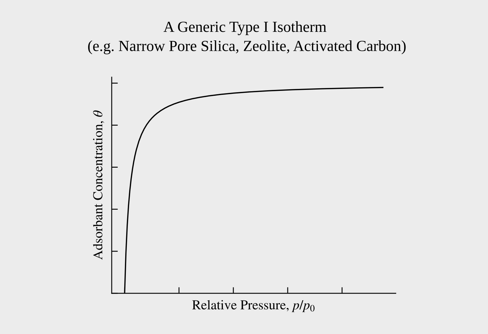
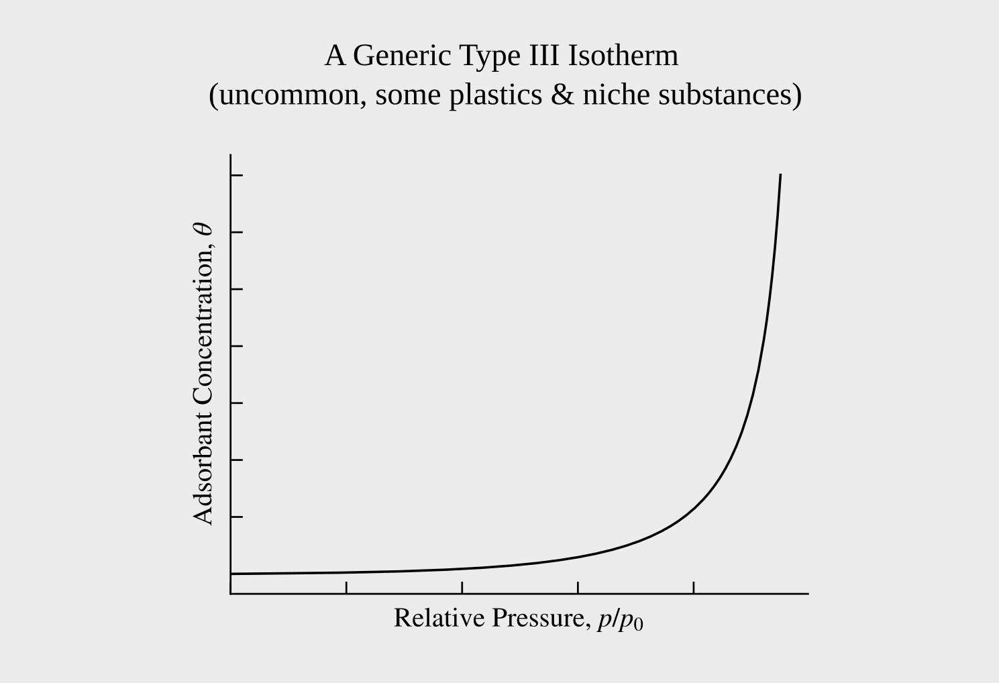
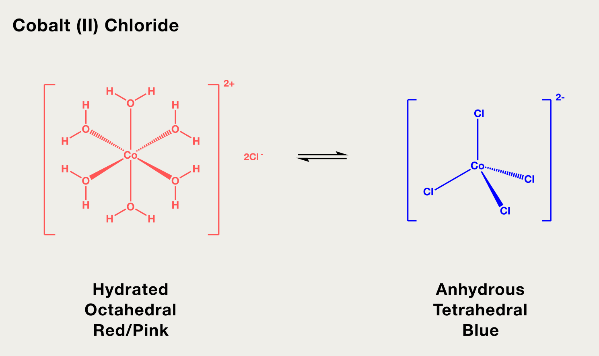
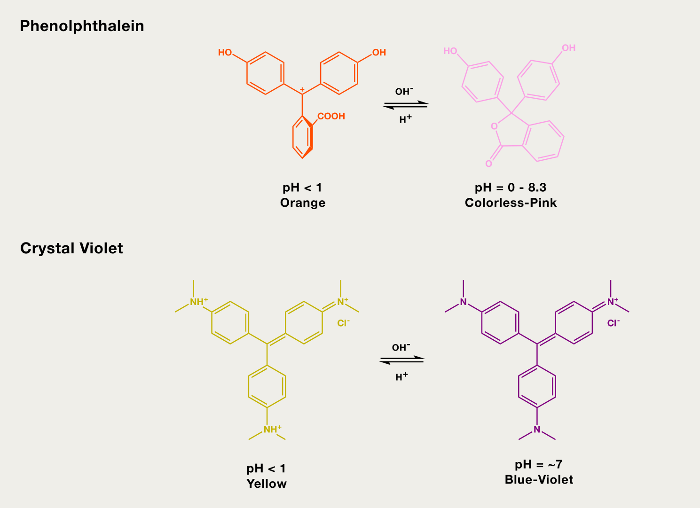
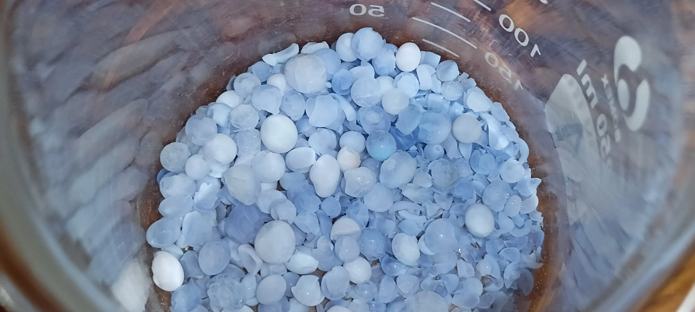
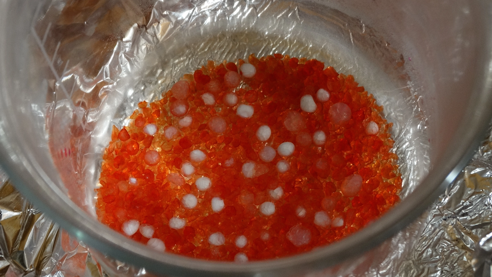
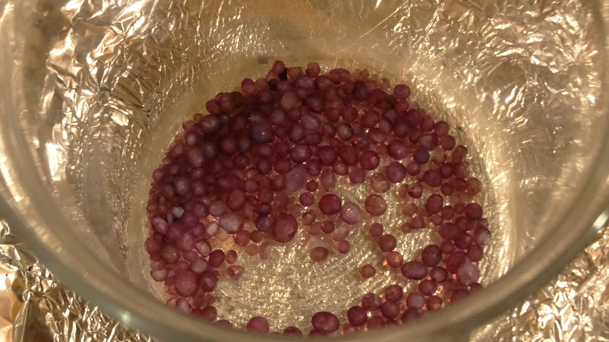
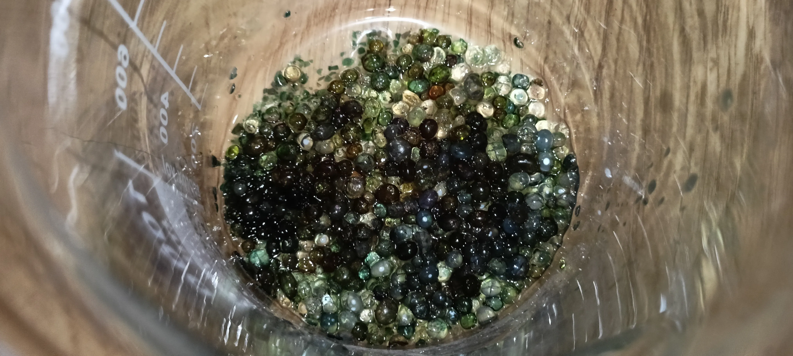
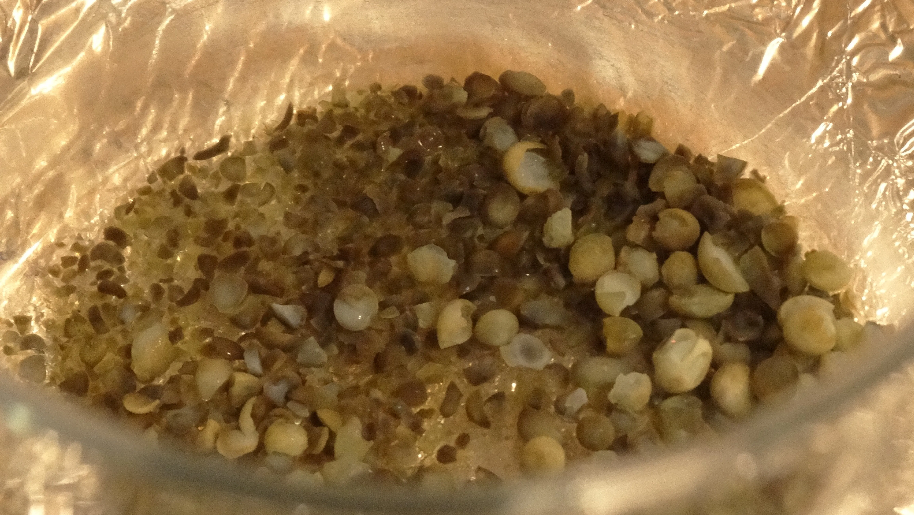
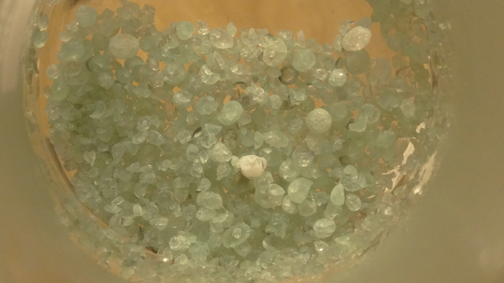

Back in June, currentyear we have decided to sweep through our lab on a mission to eliminate inefficiencies & sources of contamination after we'd almost ruined our entire stock of Cesium Carbonate by leaving it in an iodine-contaminated desiccator. In the process of decontamination, the vessel in question was emptied of its old calcium chloride drying agent and thoroughly washed in order to remove all traces of halogens. But then our task at hand was interrupted by the fact that the big jar of calcium chloride (our favourite desiccant) exploded in storage, leaving us with two giant shards of glass and a big moist lump of CaCl2 we did not feel like dealing with. 

The reason why Calcium Chloride and not silica gel is our favourite desiccant is that calcium chloride comes with its own built in saturation indicator in the form of deliquescence. Spent CaCl2 will form a big chunk or even a puddle on saturation, while silica gel retains its mechanical structure over the whole range of humidity, unless you suddenly hit it with an excessive amount of moisture. This is advantageous for things like food storage or for its applications in the shipping industry, but which does us no service in our desiccators. This flaw is rectified by some industries by the application of Indicator Silica.  

So in order to celebrate No Effort ~~November~~ October we have decided to move focus away from any sort of theory heavy chemistry or advanced inorganic synthesis towards something that seemed much simpler and more commonly appreciated - Indicator Silica. How it's produced, how it works, and the caveats that are involved therein. 

## The Typology of Indicator Silica
As of October 2026, indicator silica mostly comes in two flavours, the original cobalt chloride and the new "cobalt-free" form. These are two are equally effective as desiccants and only differ by the humidity indicator they contain. In the second type, the cobalt is replaced in a favour of a supposedly less toxic organic dye (usually something like Crystal Violet). The latter kind became more widespread around the 2000s when the European Union classified soluble cobalt salts as toxic/carcinogenic[^1]. 

This ruling led to an interesting conclusion in that there is now a secret third category of silica gel that is sold as "cobalt **chloride** free" and not "**cobalt** free". While this sort of naming is correct, these desiccants still contain the scary soluble cobalt in the form of a tetrachlorocobaltate salt which is cobalt chloride in every toxicological sense of the term. (the chemical composition of the solid compound is different but in solutions salts like this dissociate to cobalt chloride). A little snag for you to look out for if you are using the silica gel around food or pets or whatever else that does not appreciate extra Cobalt.[^2]

## How do Silica and Indicator Silica Work? 
Silica gel is a highly porous material that holds water by the mechanism of Physical Adsorption. In the parts of physical chemistry that deal with sorption we split the processes into mainly two categories: **adsorption** and **absorption**. 

The difference between them is that **absorption** involves the entire bulk solid holding onto moisture (happens with fibrous/filamentous materials like cloth, for example), while **adsorption** only happens at or near the surface of our solid. There is also a third category that is Ion Exchange, but the ion exchange resin masterpost will have to wait a few more years so don't bother with it yet. Surface adsorption is the defining mechanism of how silica gel and other common desiccants like molecular sieves or alumina work in everyday humidity control applications. **Physical** Adsorption means that our substrate does not actually react chemically with the adsorbate (in this case water) and that it is held in there purely by weaker forces like van der Waals or hydrogen bonds. In contrast, chemical adsorption happens in things like automotive catalytic converters where the nanoparticles of precious metals actually react with the harmful nitrogen oxides and form intermediary chemical compounds.

The way physical chemistry describes this is by the application of an Adsorption Isotherm[^3] - a plot of amount of adsorbed adsorbate with regards to the relative vapour pressure of the adsorbed substance. (the exact coordinates for the plot may vary but they usually have the y axis set to amount of adsorbate (be it in a percentage or mass or something similar) on the surface and the x axis to some form of concentration of the adsorbate in the atmosphere)

There exist many different models for this, such as Henry, BET, Langmuir, Freundlich and other isotherms, all differing in complexities, scope and applications. We will not focus on any model in particular and instead just look at the adsorption isotherms in general. Regardless of the model, IUPAC gives us 8 "model-agnostic" (mostly) adsorption isotherm shapes. So, for example, something like silica gel any other similar good drying agents/adsorbants will have a Type I isotherm.[^4]

 

Interestingly, these models are useful enough to describe **bulk** absorption in something like for example, 3D printing filament. According to this[^5] paper, PLA has a linear (Henry) isotherm, while ABS and the infamously hygroscopic Nylon have a Type III Isotherm that can be described by BET. The actual mechanisms are quite different in polymeric substances though, with it being treated more like standard diffusion with calculation done via Fick's Law rather than with any of the surface adsorption models.

 

Indicator silica isn't any different from normal silica, with the exception that a small amount of moisture sensitive indicator compound is added. This compound resides at the surface of our gel and reacts in a certain way with water, changing the colour over time the more humidity is present. This is a reversible process, and in theory, we can cycle our indicator silica an unlimited amount of times before it breaks.[^6]

Inorganic humidity indicators are most of the time salts or complexes of various transition metals. The most widespread salts used for these purposes are metal halides, as they come with a nice sharp colour change and are usually pretty cheap. Cobalt silica before the aforementioned EU ruling for example relies on the formation of a tetrahedral blue tetrachlorocobaltate complex driven by the removal of the aquo ligands from cobalt's octrahedral coordination sphere. 

 

The more interesting mechanisms occur with the organic indicators, where the main role is played not by a ligand and geometry change but usually by the pH of the surface. Silica Gel by itself is quite acidic, so in a dry state, a dye like Phenolphtalein will have an orange colour corresponding to the fully protonated form, while with the increasing humidity it loses colour, indicative of the neutral form of the dye (similar to the less non-protonated pure neutral solid)

 

## Synthesis 
There exist two main routes of preparing doped silica gels. If you're doing an actual interesting project the cooler way to do it is to prepare a solution of dopant mixed in with TEOS or other silica gel precursor, and then to form the gel with the dopant already included. This ensures a pretty uniform distribution and is a commonly employed technique in actual synthetic laboratories. The more boring way is to simply adsorb some of your dopant onto the surface of the silica by simply adding a solution of it beads that have been prepared beforehand for you. We are doing the latter because it is simply not worth it to crack out the TEOS for This. The silica gel was bought from a local chemical supplier although beads bought from a 3D printing shop or salvaged from a pile of torn moisture packets will suffice.

### CoCl2 
This one came out slightly wrong because of a few missteps. The most likely mistakes we have done here were the addition of the metal salt solution to a still hot pile of silica (this fragged our nice 400 ml beaker) and the fact that we did it in more or less one portion. This made our indicator very unevenly distributed among the beads and caused the colour to look slightly washed. On the bright side, our final desiccant looks a bit like blueberries. The coating solution consists of 100 mg of CoCl2 hydrate dissolved in 10 ml of dH2O and the mass of beads used is 10 grams.

 

Because of this mistake we don't get a colour change as intense as we would've wanted, and instead on addition of water our desiccant desaturated and went towards more so a demure purple-lilac rather than a cobalt pink. 

### Phenolphtalein
As lightly less often encountered kind of non-cobalt containing silica gel, however it was well described in a patent[^7] we found while doing research for this article.

 

10 grams of silica gel beads were heated to dryness and left to cool down to room temperature, after which 7 ml of solution of 50 milligrams of phenolphthalein and 100 milligrams of potassium hydroxide in 50 ml of water were added in installments, mixing thoroughly to ensure even coating.

### Crystal Violet
This is the part where everything falls apart. There exists no good literature on how the very widespread green-orange indicator silica is made. The one bit of literature we could find is a patent in Korean[^8] with a godawful translate job and even they don't make the green-orange stuff in particular. 

 

The best results we personally got were by adding a bunch of extra hydrochloric acid to beads doped with 5-7 ml of 0.04% neutral crystal violet in 90/10 water:methanol solution. 

 

The obtained beads were pretty ugly and did not tolerate drying very well. At some point we got into an unpleasant groove of going to university to do chromatography (great, even more fucking silica gel) and then going home to do more silica chemistry in the time when the power outage schedules even allowed us to. This was then compounded by the grueling 6/1 university schedule to the point where the latter half of october was turned into an utterly joyless, occasionally soul-crushing period of time with next to no reprieve. Not a way to live and not even the recently upped to 30 mg dose of Mirtazapine helped us cope with the sheer amount of silicon dioxide in our lives. 

If anyone considers improving on this, our suggestions are to keep the indicator load **very light** by w/w and to use a strong acid (our attempts to use 85% phosphoric acid as a pH adjusting agents were not very succesful) 

### Bonus: CuCl2 
Not something you'd really encounter as a commercial desiccant, although ferric chloride based preparations seem to be used on occasion. (but we have a horrible bias against iron as an element so we won't be making it this time).

 

And it is not something you often encounter for good reason. A very disappointing indicator. When dry, the green-brown-black colours make the indicator resemble some form of obscure pea-based dish that you'd probably see served in a Wetherspoons situated inside of a His Majesty's Prison Service Facility. Although it is a pretty nice "baby green" when saturated with moisture so maybe its really not all that bad. Not recommended. 

 

## Conclusions 
Our main goals with this writeup were to find out whether if we could make indicator silica at home and whether if it was worth it whatsoever. The answer to the first question is a shaky yes and the answer to the second is a medium-strength no. The phenolphthalein silica is trivial and pleasant to make, while the other kinds are more or less not worth it money and time investment wise (we spent more money on the little jar of crystal violet than what it would cost us to buy a big jar of commercially prepared cobalt-free indicator silica). This is definitely enough silica chemistry for maybe the rest of this year, sans the godawful tar column that we still have to attend to well into november. More exciting chemistry is to come soon hopefully, Peace. 

## Footnotes
[^1]: [Humidity indicator card # Cobalt-free humidity indicator cards - Wikipedia ](https://en.wikipedia.org/wiki/Humidity_indicator_card#Cobalt-free_humidity_indicator_cards) (all the sources here are gone and trying to look in an EU database gave us a dead link that was also in Croatian)
[^2]: evidence of it happening: [https://www.reddit.com/r/chemistry/comments/1r9vlv1/so_is_the_claim_to_be_cobalt_chloride_free_a/](https://www.reddit.com/r/chemistry/comments/1r9vlv1/so_is_the_claim_to_be_cobalt_chloride_free_a/)
[^3]: [Moisture sorption isotherm - Wikipedia](https://en.wikipedia.org/wiki/Moisture_sorption_isotherm)
[^4]: assuming small enough pore in silica. large pore silica gel has the shape of a Type IV isotherm and exhibits adsorption hysteresis. which we couldn't mention in the main article due to our lack of time...
[^5]: Aniskevich A, Bulderberga O, Stankevics L. Moisture Sorption and Degradation of Polymer Filaments Used in 3D Printing. Polymers (Basel). 2023 Jun 7;15(12):2600. doi: [10.3390/polym15122600](https://pmc.ncbi.nlm.nih.gov/articles/PMC10304609/). PMID: 37376246; PMCID: PMC10304609. 
[^6]: Not accounting for things like hydrolysis, though your silica gel will fail much earlier than your indicator most of the time 
[^7]: [Silica gels with moisture indicator, a method of obtaining them, and use of phthalein dyes](https://patents.google.com/patent/WO2006130029A2/en)
[^8]: [Desiccant containing moisture absorption indicator and method for producing the same](https://patents.google.com/patent/KR100894629B1/en)

